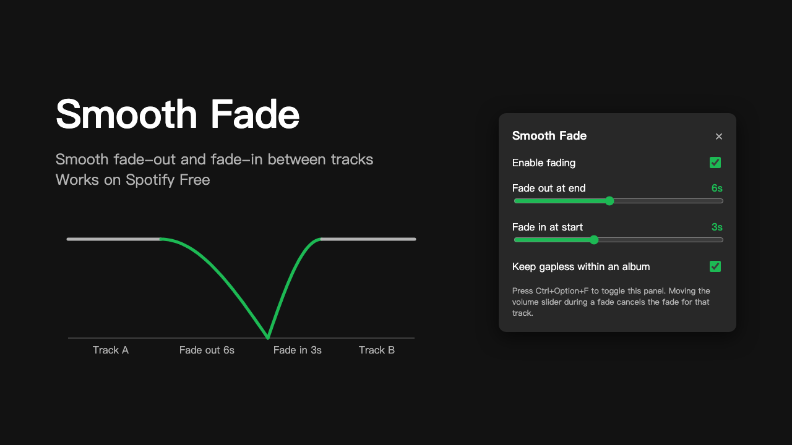

# Smooth Fade

A [Spicetify](https://spicetify.app) extension that fades the volume out at the end of each track and back in on the next one, so track changes stop sounding like hard cuts. Works on Spotify Free.



## Why

Spotify's built-in Crossfade is now Premium-only. On a free account, every track change is a hard cut.

Spicetify extensions run in Spotify's UI layer and can't access the audio stream, so they can't play two tracks at once. Smooth Fade only controls the volume: the tracks don't overlap, and there's a short quiet dip between them. It's much smoother than a hard cut, but it is not a true crossfade like Apple Music's.

If you have Premium, Spotify's own Crossfade or Mixed Playlists will sound better.

## Features

- Fade out over the last 1–12 seconds (default 6) and fade in over the first 0–8 seconds (default 3)
- Keeps gapless playback when the next track is from the same album (can be turned off)
- Moving the volume slider during a fade cancels the fade for that track and keeps your new volume
- Skipping manually during a fade-out still fades the next track in
- Pausing for more than 1.5 seconds restores the volume; if Spotify is closed mid-fade, the volume is restored on next launch
- Ads and podcasts are left alone

## Install

### Spicetify Marketplace

Search for **Smooth Fade** under Extensions in the Marketplace and click Install.

### Manual

1. Put `smoothFade.js` in your Spicetify Extensions folder:
   - macOS / Linux: `~/.config/spicetify/Extensions/`
   - Windows: `%appdata%\spicetify\Extensions\`
2. Run:

   ```sh
   spicetify config extensions smoothFade.js
   spicetify apply
   ```

After Spotify restarts, a "Smooth Fade loaded" message appears near the bottom of the window.

## Settings

Press `Ctrl+Option+F` on macOS or `Ctrl+Alt+F` on Windows/Linux to open the settings panel.

The extension also tries to add entries to the top bar, the playbar, and the profile menu. On Spotify 1.3.8 with Spicetify 2.46.4, these may not appear, because that Spicetify release officially supports macOS Spotify only up to 1.3.7. The keyboard shortcut works either way.

## Uninstall

```sh
spicetify config extensions smoothFade.js-
spicetify apply
```

## How it works

Every 100 ms the extension reads the playback position, computes a volume factor from the time remaining (a sine curve), and sets the volume with `Spicetify.Player.setVolume`. Because the volume is derived from the playback position rather than a timer, pausing, seeking, and repeat-one all stay in sync.

## License

MIT
